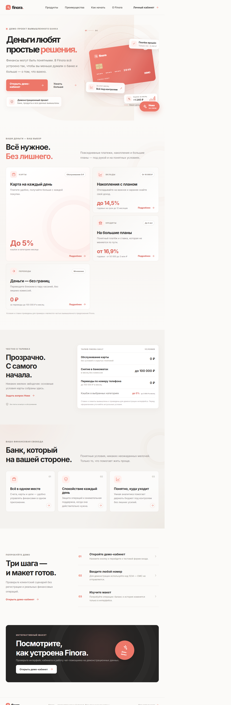
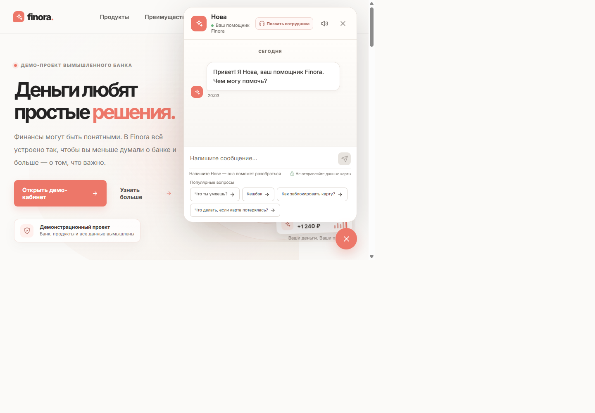
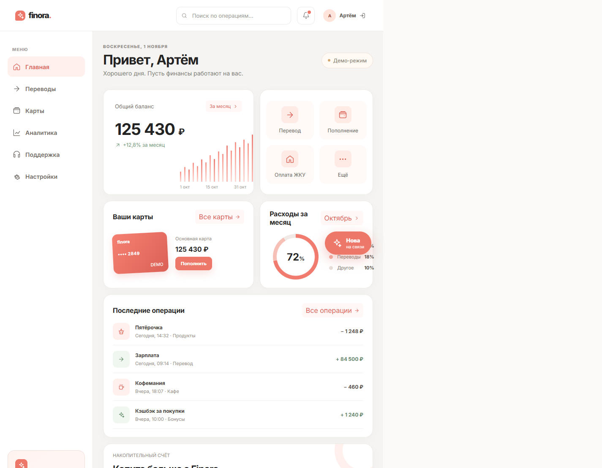
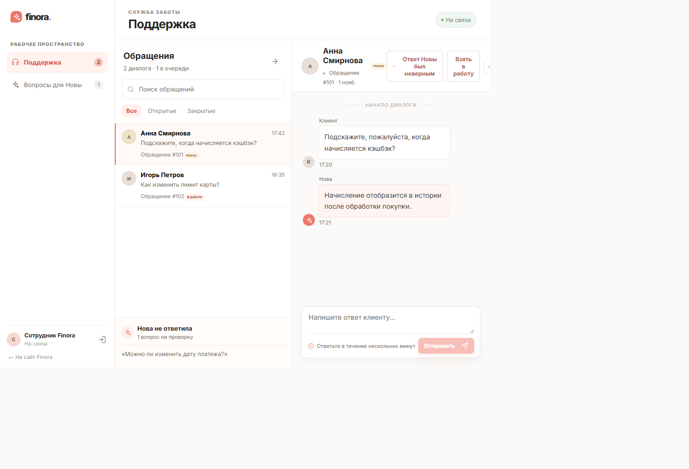
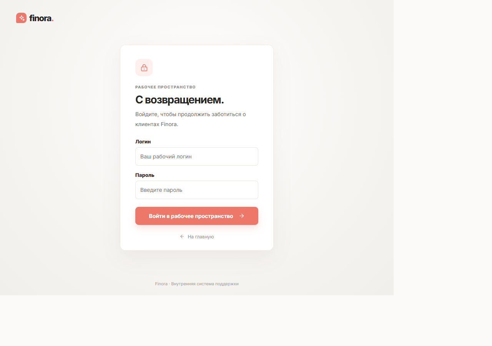

# Finora

Finora — учебный демонстрационный проект банковского интерфейса: главная страница, клиентский кабинет, чат-помощник Нова и рабочее место службы поддержки.

> Finora не является банком или финансовой организацией. Названия, продукты, ставки, клиенты, обращения и операции вымышлены. Проект предназначен для демонстрации интерфейсов и программной логики; он не открывает реальные счета, не выполняет платежи и не принимает настоящие учётные данные.

Нова ищет ответы в локальной базе FAQ с помощью TF-IDF, символьного сходства и коррекции частых опечаток. Для коротких сообщений с названием темы она предлагает связанные вопросы. Внешние языковые модели не используются.

## Технологии

- **Frontend:** Vue 3, Vite, Pinia.
- **Backend:** Python 3.12, FastAPI, SQLAlchemy, Alembic.
- **Хранение данных:** SQLite локально; PostgreSQL в Docker Compose.
- **Поиск по FAQ:** scikit-learn, TF-IDF и символьное сходство.

## Запуск в Docker

1. Скопируйте `.env.example` в `.env` и задайте пароль сотрудника, пароль PostgreSQL и секрет JWT. Используйте только демонстрационные значения и не публикуйте `.env`.
2. Запустите `docker compose up --build`.
3. Откройте сайт на [http://localhost:5173](http://localhost:5173), документацию API — на [http://localhost:8000/docs](http://localhost:8000/docs).
4. Войдите в панель на странице `/staff` с логином и паролем из `.env`.

Кнопка «Личный кабинет» открывает демонстрационный вход на `/account`. Используйте вымышленный номер и код `1234`, чтобы увидеть пример баланса, операций и карты. Это не настоящая авторизация, а данные кабинета не связаны с реальными счетами.

Для локальной разработки без Docker фронтенд запускается через `npm install` и `npm run dev` в `frontend`, а API — командами из `backend/README.md`. SQLite используется, если `DATABASE_URL` не задан.

## Скриншоты интерфейса

### Главная

### Чат с Новой

### Личный кабинет

### Рабочее место сотрудника

Все имена, обращения, сообщения, балансы и операции на скриншотах вымышлены. В рабочем месте сотрудника показаны демонстрационные данные.

### Вход сотрудника

## Проверки

В backend находятся pytest-тесты API и поиска по 181 записи FAQ с 681 вариантом формулировок. Отдельная проверка прогоняет все 100 вопросов из продуктового списка; оценка поиска на фиксированных примерах и команда запуска описаны в `backend/README.md`.
